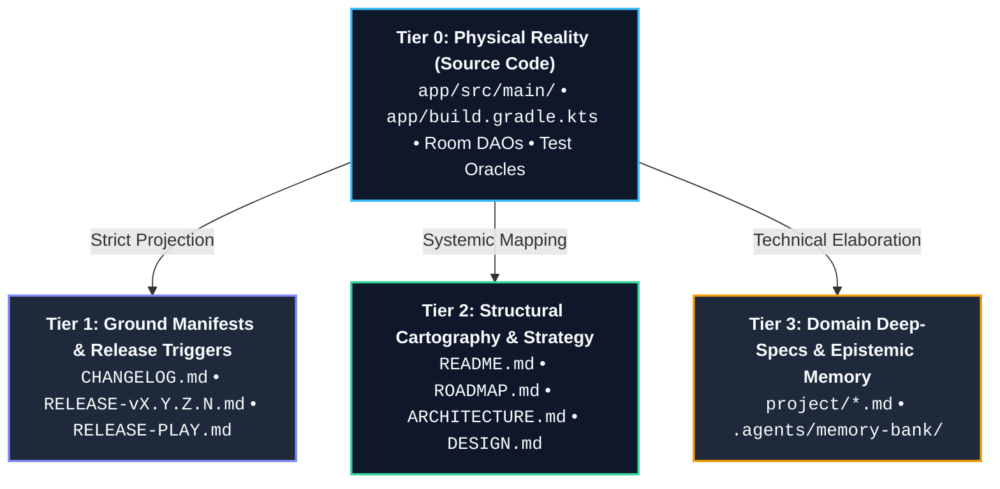

# 📚 Skill: Deterministic Documentation Automation (Docs Bow to Code)

This skill provides the architectural foundation, automation patterns, and verification procedures to ensure that all root-level project documentation remains in 100% deterministic synchronization with the physical codebase.

---

## 🏛️ The Core Axiom: Docs Bow to Code

> **The codebase is the physical, ground-truth reality.**
> Documentation is a compiled projection or structural attestation of that reality.
> If the documentation and the code disagree, **the documentation is defective by definition.**
> The code never changes to satisfy obsolete documentation; the documentation must unconditionally bend, update, and bow to the code.

Under this paradigm, documentation is treated as a **compiled artifact** governed by the project's Definition of Done (DoD). A code modification without its matching documentation attestation is structurally incomplete and must never pass pre-commit or release gates.

---

## 🎯 When to Use This Skill

- **Database & Entity Changes**: Modifying Room `@Entity`, `@Dao`, database version, or SQLCipher migrations.
- **Cryptography & Key Management**: Altering Android KeyStore aliases, cipher modes (AES-GCM-256), HKDF derivations, or zeroization receivers (`PanicTriggerReceiver`).
- **UI & Navigation Evolution**: Adding/modifying Compose screens, `TotpNavHost` routes, or `ShellGuardTypography`/theme tokens.
- **Sync & Wire Contracts**: Altering REST DTO schemas, dynamic RFC 6238 Key URI parsing, or `compatibility_layer.md` contracts.
- **Versioning & Release Preparation**: Bumping `versionCode` / `versionName`, completing roadmap phases, or staging GitHub/Play Store distribution assets.
- **Documentation Drift Auditing**: Verifying internal relative markdown links, test count badges, and store listing character constraints.

---

## 🧭 The Single Source of Truth (SSoT) Hierarchy

To eliminate contradictory claims across documents, information flows strictly downwards through four epistemic tiers:



1. **Tier 0 (Physical Reality)**: The source code (`.kt`, `.kts`, `.xml`), Gradle build definitions, and passing unit test suites. All claims originate here.
2. **Tier 1 (Ground Manifests)**: Direct changelog records, release notes, and distribution descriptors derived mathematically from git diffs and commit history.
3. **Tier 2 (Structural Cartography)**: High-level architectural overviews, user-facing feature indexes, and strategic milestone tracking.
4. **Tier 3 (Domain Deep-Specs & Memory)**: Deep-dive specifications (`project/*.md`) and agent memory banks capturing felt constraints and rationales.

---

## 🔍 The 4 Classes of Documentation Drift

| Drift Class | Root Cause | Example Failure Mode | Automated Prevention |
| :--- | :--- | :--- | :--- |
| **1. Metric Drift** | Tests added or versions bumped without updating badges/prose. | `README.md` claims "96 tests passing" when test runner outputs `107 tests`. | Regex assertion against test execution outputs. |
| **2. Schema & Contract Drift** | Room schema bumped (v1 ➔ v2) or DAO query modified without updating specs. | `room-storage-schema.md` omits `audit_logs` table while entity exists in code. | AST / Grep verification against `@Entity` declarations. |
| **3. Strategic Blast-Radius Drift** | Hotfix inserted without re-aligning downstream build numbers. | `ROADMAP.md` predicts Phase 13 as Build 16, but Hotfix v0.0.2.2 consumed Build 15. | Monotonic sequence linter for `(Build N)` tags. |
| **4. Store Constraint Leakage** | Markdown syntax or long text pasted into mobile store files. | `RELEASE-PLAY.md` contains `**bold**` or exceeds 500 chars, causing Play Console upload failure. | Plain-text linter & character length gate (`len < 500`). |

---

## 🗺️ The 9-Point Root Documentation Mesh

Every completed phase, refactor, or release must be attested across this synchronized 9-point mesh:

```
[Physical Code Changes in Git Tree]
          │
          ├── 1. app/build.gradle.kts ────────► versionCode = N + 1, versionName = "X.Y.Z.N"
          ├── 2. ROADMAP.md ──────────────────► [x] Task, current_position, monotonic Build N
          ├── 3. CHANGELOG.md ────────────────► ## [X.Y.Z.N] - YYYY-MM-DD (Build N) + compare link
          ├── 4. RELEASE-vX.Y.Z.N.md ─────────► Summary, Highlights, Test Gate verification
          ├── 5. RELEASE-PLAY.md ─────────────► <en-US> block (<500 plain text chars, 0 markdown)
          ├── 6. README.md ───────────────────► Version badge, test count badge, tech stack table
          ├── 7. project/*.md & ARCHITECTURE ─► Schema versions, KeyStore aliases, wire contracts
          ├── 8. SECURITY.md ─────────────────► Supported versions, cryptographic threat model, SLAs
          └── 9. .agents/memory-bank/ ────────► activeContext (slide 10), progress, learnings
```

### Detailed Mesh Invariants:

#### 1. Central Build Manifest (`app/build.gradle.kts`)
- **Truth Anchor**: `defaultConfig { versionCode = N; versionName = "X.Y.Z.N" }`.
- **Invariants**:
  - `versionCode` is a strictly monotonic incrementing integer (`N + 1`).
  - `targetSdk` is pinned to API 36 (Android 16) per Google Play Console requirements.
  - Native packaging enforces `useLegacyPackaging = false` for 16 KB page-size compliance.

#### 2. Strategic Roadmap (`ROADMAP.md`)
- **Truth Anchor**: Completed tasks marked `[x]`, active phase denoted in `current_position`.
- **Invariants**:
  - Progress metric `features_completed: XX%` must match actual `[x]` vs `[ ]` ratio.
  - **Downstream Monotonic Blast-Radius Guard**: All upcoming phase headers (`Phase X (Build Y)`) must strictly increment `Build Y` sequentially. If an interlude hotfix increments a build code, all subsequent planned phases must be updated to maintain monotonic integrity.

#### 3. Public Changelog (`CHANGELOG.md` at Root)
- **Truth Anchor**: Git history and Conventional Commits since previous tag.
- **Invariants**:
  - Adheres strictly to **Keep a Changelog 1.1.0** standards.
  - Groups work under 6 canonical headers: `Added`, `Changed`, `Deprecated`, `Removed`, `Fixed`, `Security`.
  - Maintains compare anchors at document footer (`[X.Y.Z.N]: https://github.com/.../compare/...`).

#### 4. Milestone Technical Dossier (`RELEASE-vX.Y.Z.N.md`)
- **Truth Anchor**: Full pre-flight verification gate and git commit range.
- **Invariants**:
  - Must exist at repository root with exact naming `RELEASE-v<versionName>.md` (trigger file for CI release notes parser).
  - Itemizes test count (e.g. `107/107 green`), clean build status, and schema migration deltas.

#### 5. Mobile Store Distribution Notes (`RELEASE-PLAY.md`)
- **Truth Anchor**: High-impact user-facing features extracted from `CHANGELOG.md`.
- **Invariants**:
  - Wrapped inside `<en-US>` tags.
  - **Strict Length Ceiling**: Exactly `< 500 characters` per language block.
  - **Zero-Markdown Mandate**: No asterisks (`*`), hashes (`#`), backticks (`` ` ``), or HTML tags. Google Play Console renders markdown verbatim, exposing raw symbols to end users.

#### 6. Repository Gateway (`README.md`)
- **Truth Anchor**: Verified production capabilities and test oracle metrics.
- **Invariants**:
  - Version badge mirrors `app/build.gradle.kts` (`vX.Y.Z.N (Build N)`).
  - Passing test count in prose and badge mirrors actual JUnit/Robolectric test totals (`./gradlew testDebugUnitTest`).
  - Documentation Index table contains valid, non-broken relative links to all root and `project/` documents.
  - Native hardware screenshots grid matches active theme palettes and UI states.

#### 7. Domain Specifications (`project/*.md` & `ARCHITECTURE.md`)
- **Truth Anchor**: Specific code subsystems.
  - `project/room-storage-schema.md` bows to `ShellGuardTotpDatabase.kt` and `*Entity.kt`.
  - `project/crypto-and-keystore.md` bows to `AndroidKeyStoreHelper.kt` and `EncryptedDeviceVault.kt`.
  - `project/routes-and-contracts.md` bows to `ApiClient.kt` and `TotpUriParser.kt`.
  - `ARCHITECTURE.md` bows to client operational modes (Local Standalone vs Server Connected).

#### 8. Security Policy & Posture (`SECURITY.md`)
- **Truth Anchor**: Active release version, supported API ranges, and active cryptographic defense implementations.
- **Invariants**:
  - Supported Versions table mirrors active release version (`vX.Y.Z.N (Build N)`).
  - Documents active ciphers (SQLCipher 4.6.1 AES-256, StrongBox KeyStore aliases, `FLAG_SECURE`, IME dictionary protection, panic purge).
  - Maintains private reporting mechanisms, response SLAs (48h acknowledgment), and threat model boundaries.

#### 9. Epistemic Memory Bank (`.agents/memory-bank/`)
- **Truth Anchor**: Realized development lifecycle and agent decisions.
- **Invariants**:
  - `activeContext.md`: Sliding window of exactly 10 chronological events.
  - `progress.md`: Phase status and test coverage metrics synchronized.
  - `consolidated_learnings.md`: Durable architectural patterns distilled.

---

## 🛠️ Tooling & Implementation Blueprints

### Blueprint A: Deterministic Doc-Drift Auditor Script (Python CLI)
Automate verification before every release commit. This script parses the codebase truth and asserts that all documentation files agree:

```python
#!/usr/bin/env python3
"""
scripts/audit_docs_drift.py
Deterministic documentation drift auditor for ShellGuard-TOTP.
Asserts that root documentation 100% bows to the code.
"""

import re
import sys
from pathlib import Path

ROOT = Path(__file__).resolve().parent.parent

def check_build_gradle():
    build_gradle = (ROOT / "app/build.gradle.kts").read_text()
    vcode_match = re.search(r'versionCode\s*=\s*(\d+)', build_gradle)
    vname_match = re.search(r'versionName\s*=\s*"([^"]+)"', build_gradle)
    if not vcode_match or not vname_match:
        sys.exit("[-] Could not parse versionCode or versionName from app/build.gradle.kts")
    return int(vcode_match.group(1)), vname_match.group(1)

def audit_readme(vcode, vname):
    readme = (ROOT / "README.md").read_text()
    expected_badge = f"version-v{vname}%20(Build%20{vcode})"
    if expected_badge not in readme and f"version-v{vname}" not in readme:
        print(f"[!] Warning: README.md badge does not reflect current version v{vname} (Build {vcode})")
        return False
    print("[+] README.md version badge in sync.")
    return True

def audit_release_play():
    play_file = ROOT / "RELEASE-PLAY.md"
    if not play_file.exists():
        sys.exit("[-] RELEASE-PLAY.md missing from repository root.")
    content = play_file.read_text()
    blocks = re.findall(r'<en-US>(.*?)</en-US>', content, re.DOTALL)
    if not blocks:
        sys.exit("[-] RELEASE-PLAY.md missing <en-US> block.")
    
    latest_block = blocks[0].strip()
    char_len = len(latest_block)
    if char_len >= 500:
        sys.exit(f"[-] RELEASE-PLAY.md latest block exceeds 500 characters: {char_len}/500 chars!")
    
    # Check for markdown leakage
    markdown_symbols = ["**", "##", "`", "```"]
    for sym in markdown_symbols:
        if sym in latest_block:
            sys.exit(f"[-] RELEASE-PLAY.md contains forbidden markdown syntax: '{sym}'")
    
    print(f"[+] RELEASE-PLAY.md validated: {char_len}/500 chars, zero markdown leakage.")
    return True

def audit_changelog(vname, vcode):
    changelog = (ROOT / "CHANGELOG.md").read_text()
    expected_header = f"## [{vname}]"
    if expected_header not in changelog:
        sys.exit(f"[-] CHANGELOG.md missing release section header for {expected_header}")
    
    # Check for compare link
    expected_link = f"[{vname}]:"
    if expected_link not in changelog:
        sys.exit(f"[-] CHANGELOG.md missing footer comparison link for [{vname}]")
    print(f"[+] CHANGELOG.md has entry and compare link for v{vname} (Build {vcode}).")
    return True

def main():
    print("[*] Running ShellGuard-TOTP Documentation Drift Audit...")
    vcode, vname = check_build_gradle()
    print(f"[*] Physical Code Truth: versionName='{vname}', versionCode={vcode}")
    
    success = True
    success &= audit_readme(vcode, vname)
    success &= audit_release_play()
    success &= audit_changelog(vname, vcode)
    
    if not success:
        sys.exit(1)
    print("[✓] All root documentation 100% bows to the code!")

if __name__ == "__main__":
    main()
```

---

### Blueprint B: Relative Markdown Link Integrity Checker
In CI, verify that all markdown links within root documents resolve to existing files:

```bash
#!/usr/bin/env bash
# Verify all relative markdown links in README.md and root docs
set -euo pipefail

echo "[*] Auditing root markdown file hyperlinks..."
python3 -c "
import re, sys, os
from pathlib import Path

root = Path('.')
md_files = list(root.glob('*.md')) + list(root.glob('project/*.md'))

broken = 0
for md in md_files:
    text = md.read_text(encoding='utf-8')
    # Find markdown links [Text](path)
    links = re.findall(r'\[.*?\]\(([^http:#][^\)]+)\)', text)
    for link in links:
        target = link.split('#')[0]
        if not target:
            continue
        target_path = (md.parent / target).resolve()
        if not target_path.exists():
            print(f'[-] Broken link in {md}: {link} -> {target_path}')
            broken += 1

if broken > 0:
    print(f'[-] Total broken links: {broken}')
    sys.exit(1)
print('[+] 100% of relative documentation hyperlinks verified!')
"
```

---

### Blueprint C: GitHub Actions Automated Docs Gate (`.github/workflows/docs-integrity.yml`)
Enforce documentation integrity on every pull request and push:

```yaml
name: Documentation Integrity Gate

on:
  pull_request:
    paths:
      - '**/*.md'
      - 'app/build.gradle.kts'
      - 'app/src/main/**'
  push:
    branches:
      - main
    paths:
      - '**/*.md'
      - 'app/build.gradle.kts'

jobs:
  audit-docs:
    runs-on: ubuntu-latest
    steps:
      - uses: actions/checkout@v4

      - name: Set up Python
        uses: actions/setup-python@v5
        with:
          python-version: '3.11'

      - name: Audit Documentation Drift
        run: python3 scripts/audit_docs_drift.py

      - name: Verify Relative Hyperlinks
        run: |
          python3 -c "
          import re, sys
          from pathlib import Path
          for md in Path('.').glob('*.md'):
              text = md.read_text()
              for link in re.findall(r'\[.*?\]\(([^http:#][^\)]+)\)', text):
                  t = (md.parent / link.split('#')[0]).resolve()
                  if link.split('#')[0] and not t.exists():
                      sys.exit(f'Broken link in {md}: {link}')
          print('All links valid.')
          "
```

---

## 📋 Canonical Root Documentation Patterns

### 1. High-Contrast SSoT README Badge Cluster
```markdown
[-E4048A?style=for-the-badge&logo=android&logoColor=white)](CHANGELOG.md)
[](app/build.gradle.kts)
[](project/crypto-and-keystore.md)
[](project/16kb-page-size-alignment-guide.md)
[](LICENSE)
```

### 2. Standardized Documentation Index Table
```markdown
## 🗂️ Documentation Index

| File | Description |
|---|---|
| [**`CONTRIBUTING.md`**](CONTRIBUTING.md) | Developer onboarding guide, local environment setup, verification loops, and git conventions. |
| [**`ARCHITECTURE.md`**](ARCHITECTURE.md) | Client mode architecture, client-server relationship boundaries, and threat model. |
| [**`DESIGN.md`**](DESIGN.md) | Comprehensive Material 3 design system tokens, color palettes, and motion specs. |
| [**`ROADMAP.md`**](ROADMAP.md) | Multi-phase development roadmap tracking completed features and upcoming milestones. |
| [**`CHANGELOG.md`**](CHANGELOG.md) | Chronological version release history adhering to Keep a Changelog standards. |
| [**`RELEASE-PLAY.md`**](RELEASE-PLAY.md) | Google Play Store release notes single source of truth across all published versions. |
| [**`SECURITY.md`**](SECURITY.md) | Vulnerability disclosure policy, cryptographic threat model, and zero-knowledge invariants. |
| [**`project/routes-and-contracts.md`**](project/routes-and-contracts.md) | REST API endpoints, DTO models, and delta sync reconciliation contracts. |
| [**`project/crypto-and-keystore.md`**](project/crypto-and-keystore.md) | Complete ShellCryption specification, KeyStore derivation, and biometric integration. |
| [**`project/room-storage-schema.md`**](project/room-storage-schema.md) | Room SQLite entity definitions, DAOs, and SQLCipher configuration. |
| [**`project/totp-engine-spec.md`**](project/totp-engine-spec.md) | RFC 6238 mathematical TOTP algorithm, Base32 decoders, and Steam Guard support. |
| [**`project/16kb-page-size-alignment-guide.md`**](project/16kb-page-size-alignment-guide.md) | Android 15+ 16 KB ELF segment alignment audit procedures and native verification. |
```

### 3. Mobile Store Plain-Text Listing Block (`RELEASE-PLAY.md`)
```markdown
<en-US>
- Added Security Suite with screenshot privacy toggle & tap timeout.
- Added Emergency Panic Wipe for cryptographic vault zeroization.
- Added Security Audit Log timeline with Room persistence.
- Enhanced dynamic RFC 6238 TOTP URI sync with server delta filters.
- 100% passing tests & 16 KB memory page-size compliance.
</en-US>
```

---

## 🛡️ Best Practices: Do's and Don'ts

### Do's:
1. **Always inspect the physical git diff first**: Run `git status` and `git diff --stat` before editing docs to identify what code actually changed.
2. **Execute the 9-Point Documentation Walk on every release**: Never treat docs as an afterthought; walk all 9 anchors before pushing.
3. **Commit code and documentation in the same commit**: Enforce the "Same Commit Mandate" — prove that code and explanation evolved together.
4. **Audit downstream build projections**: When a hotfix increments a build number, ripple the increment through all future roadmap milestones.
5. **Enforce plain-text store listing invariants**: Protect `RELEASE-PLAY.md` against markdown leakage and character overflows (<500 chars).

### Don'ts:
1. **Never defer documentation updates**: "I'll update the docs later" is a broken Definition of Done.
2. **Never guess test counts or metrics**: Run `./gradlew testDebugUnitTest` and read the actual green count from the test runner.
3. **Never allow broken hyperlinks in docs**: Verify all relative file paths exist.
4. **Never let docs contradict source code**: If code removes a feature, remove or deprecate it in docs immediately.
