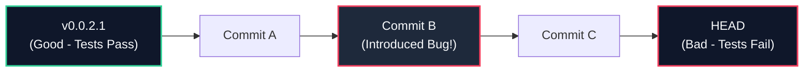

# 🔀 Skill: Git Advanced Workflows & History Engineering

This skill provides patterns, workflows, and recovery playbooks for advanced Git operations, maintaining a clean, linear commit history, isolating concurrent development tracks, locating regressions automatically via binary search, and recovering from git mistakes.

---

## 🎯 When to Use This Skill

- **Pre-PR / Pre-Merge Cleanup**: Condensing WIP commits, fixing typos, and reordering commits into clean, atomic Conventional Commits.
- **Urgent Hotfixes & Parallel Tasks**: Creating isolated `git worktree` checkouts for hotfixes or code reviews without stashing or dirtying the working directory.
- **Automated Regression Hunting**: Pinpointing the exact commit that broke a test or introduced a bug using `git bisect run`.
- **Cherry-Pick Backports**: Applying targeted security fixes or features across releases without merging entire branches.
- **Accidental History Loss / Disaster Recovery**: Restoring dropped commits, botched rebases, or deleted branches using `git reflog`.
- **Autosquash Engineering**: Automatically pairing fixup commits with their target commits during development.

---

## 🏛️ Core Concepts & Mechanics

### 1. Interactive Rebase (`git rebase -i`)
Interactive rebase is the primary mechanism for crafting a polished, readable history before publishing.

#### Command Verbs:
| Command | Action | Usage Scenario |
| :--- | :--- | :--- |
| `pick` | Keep commit as-is | Default operation. |
| `reword` | Keep commit content, edit message | Fix typos or conform to Conventional Commits. |
| `edit` | Pause rebase to amend content/split commit | Break monolithic commits into atomic units. |
| `squash` | Melt commit into previous, combine messages | Group iterative WIP commits into one logical feature. |
| `fixup` | Melt commit into previous, discard this message | Merge a minor tweak or lint fix into its parent. |
| `drop` | Delete commit entirely | Remove accidental debug logs or unwanted experiments. |

#### Standard Invocations:
```bash
# Rebase all unmerged commits on the current branch against main
git rebase -i $(git merge-base HEAD main)

# Rebase last N commits
git rebase -i HEAD~4

# Non-interactive / headless environment rebase (bypasses terminal text editor)
GIT_SEQUENCE_EDITOR=: git rebase -i --autosquash main
```

---

### 2. Autosquash Workflow (`git commit --fixup`)
Instead of manually organizing interactive rebase todo lists, use `--fixup` to tag commits during development:

```bash
# 1. Create a feature commit
git commit -m "feat(auth): implement biometric quick-unlock"
# (Hash: abc1234)

# 2. Later, fix a bug or add a missing unit test for that commit
git add app/src/test/java/BiometricTest.kt
git commit --fixup abc1234

# 3. Automatically squash during rebase without manual editing
git rebase -i --autosquash main
```
Git automatically positions the fixup commit directly below `abc1234` and sets its action to `fixup`.

---

### 3. Automated Regression Hunting (`git bisect`)
Binary searches the git commit graph to pinpoint the exact commit that broke the test suite.



#### Manual Bisect:
```bash
git bisect start
git bisect bad HEAD           # Current state is broken
git bisect good v0.0.2.0       # Known good tag
# Git checks out middle commit. Run tests, then:
git bisect good               # or: git bisect bad
# Repeat until Git reports: "abc1234 is the first bad commit"
git bisect reset              # Return to starting branch
```

#### Fully Automated Bisect with Test Oracle:
In headless Android environments, automate the entire search using the Gradle test runner:
```bash
git bisect start HEAD v0.0.2.0
git bisect run ./gradlew testDebugUnitTest --no-daemon
git bisect reset
```
*Exit code convention*: `0` = good, `1–127` (except `125`) = bad, `125` = untestable/skip.

---

### 4. Git Worktrees: Multi-Track Development
Work on multiple branches simultaneously in separate directories sharing the same underlying `.git` repository, avoiding dirty-tree stashing.

```bash
# View all active worktrees
git worktree list

# Create a clean worktree for an urgent hotfix in a sibling directory
git worktree add ../shellguard-hotfix -b hotfix/panic-wipe main

# Switch to the worktree, build, test, and commit
cd ../shellguard-hotfix
./gradlew testDebugUnitTest
git commit -m "fix(security): resolve race condition in panic purge"

# Return to main project directory
cd ../ShellGuard-TOTP

# Remove worktree once merged or finished
git worktree remove ../shellguard-hotfix
git worktree prune
```

---

### 5. Disaster Recovery via Reflog (`git reflog`)
The `reflog` records every HEAD movement (commits, resets, rebases, checkouts) and retains orphaned commits for 90 days.

#### Recovery Scenarios:

#### Scenario A: Accidental `git reset --hard`
```bash
# Oops: reset destroyed last 3 commits
git reset --hard HEAD~3

# 1. Inspect reflog
git reflog
# Output:
# abc1234 HEAD@{0}: reset: moving to HEAD~3
# def5678 HEAD@{1}: commit: feat(crypto): add StrongBox key wrapper

# 2. Restore immediately
git reset --hard def5678
```

#### Scenario B: Botched Interactive Rebase
```bash
# If rebase goes wrong mid-way:
git rebase --abort

# If rebase completed with unwanted dropped commits:
git reflog
# Locate commit right before rebase began: "HEAD@{N}: rebase -i (start): ..."
git reset --hard HEAD@{N+1}
```

#### Scenario C: Restoring Deleted Branch
```bash
# Find hash where branch pointed before deletion
git reflog | grep "checkout: moving from deleted-branch"
# Recreate branch at that commit
git branch deleted-branch abc1234
```

---

## 🛠️ Practical Blueprints

### Blueprint 1: Pre-PR Feature Branch Cleanup
Before submitting a pull request or merging into `main`:

```bash
# 1. Create a safety backup branch
git branch backup/my-feature

# 2. Rebase onto latest main with autosquash
git fetch origin
git rebase -i --autosquash origin/main

# 3. Verify the pre-flight test gate
./gradlew testDebugUnitTest

# 4. Safe force-push (NEVER use raw --force)
git push --force-with-lease origin feature/my-feature

# 5. Clean up safety branch if successful
git branch -D backup/my-feature
```

---

### Blueprint 2: Splitting a Monolithic Commit
When a commit accidentally bundles unrelated changes:

```bash
# 1. Start rebase and mark the target commit with 'edit'
git rebase -i HEAD~3

# 2. Git pauses at the commit. Reset commit while keeping files in working tree:
git reset HEAD^

# 3. Stage and commit first logical change
git add app/src/main/java/.../CryptoHelper.kt
git commit -m "refactor(crypto): extract key derivation helper"

# 4. Stage and commit second logical change
git add app/src/main/java/.../SettingsSecurityScreen.kt
git commit -m "feat(security): wire panic wipe toggle"

# 5. Continue rebase
git rebase --continue
```

---

### Blueprint 3: Selective Cherry-Picking (File-Level Backport)
When backporting only specific files from a commit:

```bash
# Inspect files in source commit
git show --stat abc1234

# Checkout only the required file from that commit
git checkout abc1234 -- app/src/main/java/com/clawstack/totp/data/TotpUriParser.kt

# Commit as a clean Conventional Commit
git commit -m "fix(sync): backport TotpUriParser RFC 6238 fix"
```

---

## 🛡️ Best Practices: Do's and Don'ts

### Do's:
1. **Always use `--force-with-lease`**: Prevents overwriting commits pushed by collaborators that you haven't fetched yet.
2. **Rebase only local, private branches**: Never rewrite history of shared branches (`main`, `master`, `release/*`).
3. **Branch before risky operations**: Run `git branch backup-<name>` before non-trivial interactive rebases.
4. **Test immediately after rebase**: Always re-run `./gradlew testDebugUnitTest` after rebasing to catch semantic conflicts that git resolved cleanly.
5. **Clean up worktrees**: Always run `git worktree remove` and `git worktree prune` after completing isolated tasks.

### Don'ts:
1. **Never use raw `git push --force`**: High risk of silent code destruction.
2. **Never rebase public history**: Rewriting shared commits creates divergent histories and merge nightmares for the entire team.
3. **Never start a bisect on a dirty working tree**: Always ensure `git status` is clean before invoking `git bisect`.
4. **Never panic on lost commits**: The `reflog` preserves virtually all commits for 90 days; inspect it before making drastic changes.
